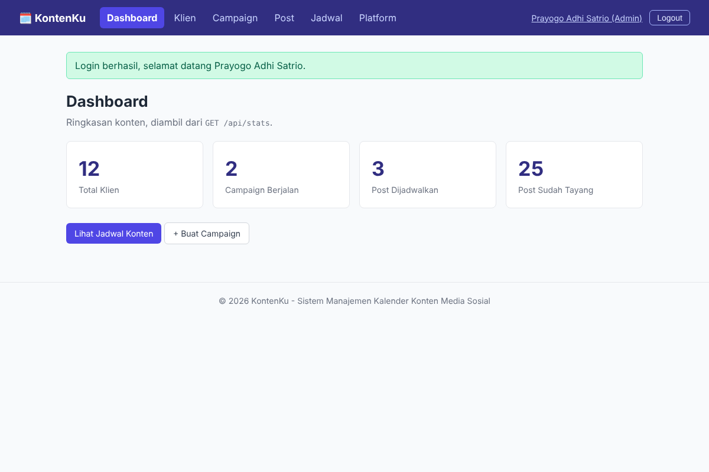
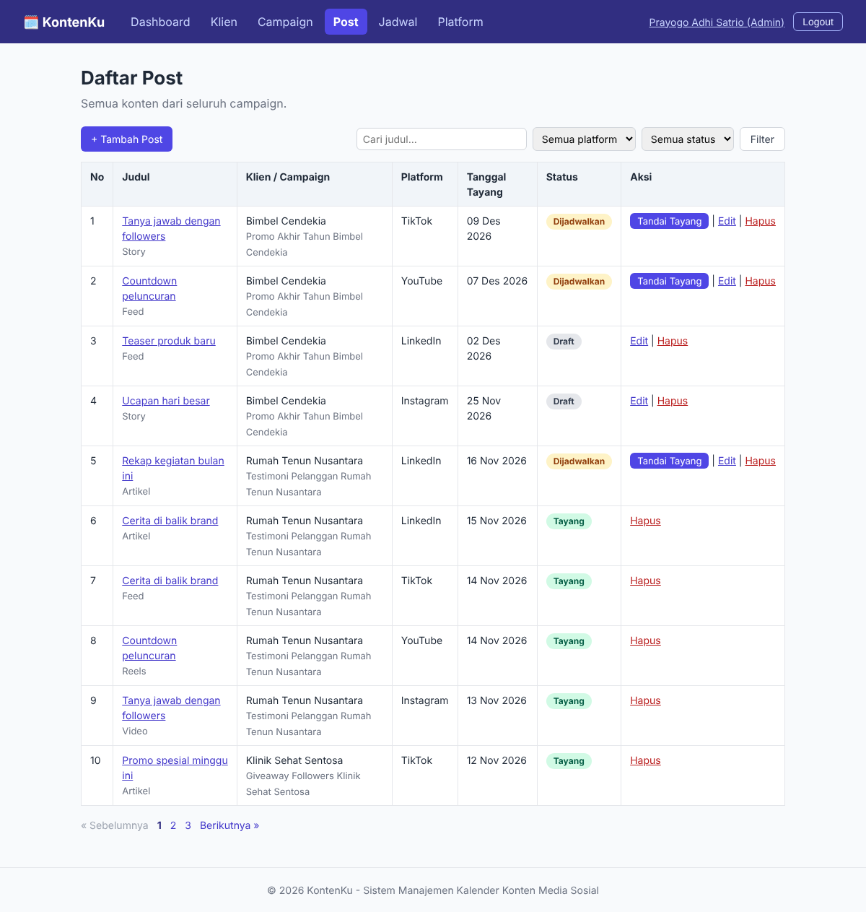
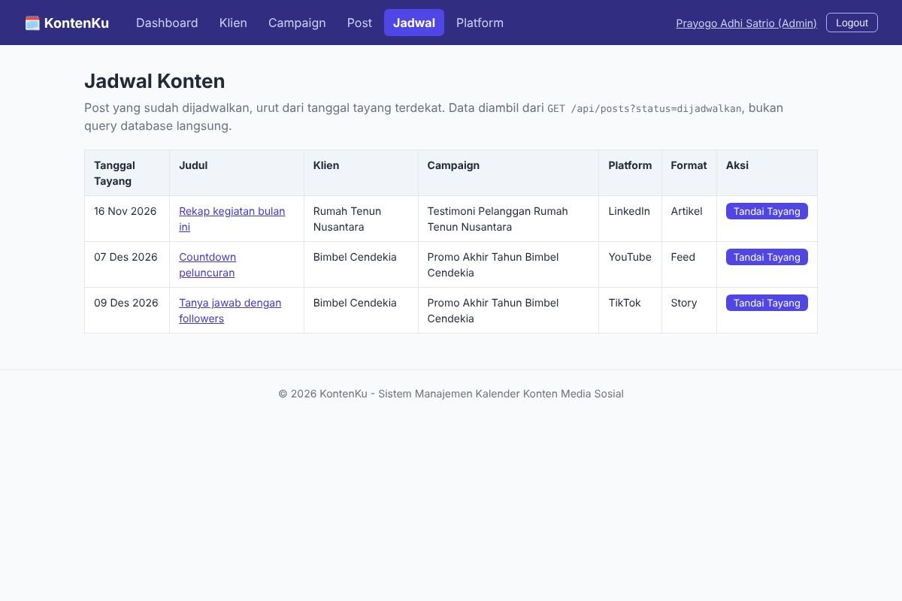

# KontenKu

**Sistem Manajemen Kalender Konten Media Sosial**

KontenKu membantu tim media sosial mengatur konten untuk banyak klien sekaligus: siapa kliennya, campaign apa yang sedang berjalan, post apa saja yang harus tayang, di platform mana, dan kapan.

Project UAS mata kuliah Workshop Pemrograman Framework, dibangun dengan **Laravel 13** dan **MySQL**.

| | |
|---|---|
| Nama | Prayogo Adhi Satrio |
| NRP | 3125600043 |
| Kampus | Politeknik Elektronika Negeri Surabaya (PENS) |



## Fitur

- **Login dan logout** berbasis session, dengan dua role:
  - **Admin**: akses penuh, termasuk mengelola daftar platform.
  - **Creator**: mengelola klien, campaign, dan post.
- **Klien**: CRUD lengkap, pencarian nama brand, dan halaman detail yang menampilkan semua campaign milik klien itu.
- **Campaign**: CRUD lengkap dan filter status. PIC campaign terisi otomatis dari akun yang login.
- **Post**: CRUD lengkap, filter judul/platform/status, dan tombol **Tandai Tayang**.
- **Dashboard** dan **Jadwal Konten**: datanya diambil dari REST API milik aplikasi ini sendiri.
- **REST API** dengan 12 endpoint. Dokumentasinya ada di [`API.md`](API.md).
- **Profil** dengan fitur ganti password.

## Alur Data

```
Klien ──< Campaign ──< Post >── Platform
              │
              └── PIC (User)
```

Satu klien punya banyak campaign. Satu campaign punya banyak post. Tiap post tayang di satu platform. Tiap campaign dipegang satu user sebagai PIC.

Alur status post: `draft` → `dijadwalkan` → `tayang`. Status `tayang` hanya bisa diisi lewat tombol **Tandai Tayang**, dan post yang sudah tayang tidak bisa diedit lagi.

## Materi Kuliah dan Letaknya di Project Ini

| Pertemuan | Materi | Implementasi |
|---|---|---|
| 1 | MVC dan struktur project | `app/Models`, `resources/views`, `app/Http/Controllers` |
| 2 | Routing, resource route, route kustom, middleware group | `routes/web.php` |
| 3 | Controller, Request, validasi, Form Request | `app/Http/Controllers`, `app/Http/Requests` (Form Request di `store`, validasi inline di `PlatformController@update`) |
| 4 | Blade, layout inheritance, partial | `layouts/app.blade.php`, `partials/`, `_form.blade.php` di tiap folder view |
| 5 | Migration, Eloquent, CRUD, `$fillable`, pagination | `database/migrations`, `app/Models`, semua controller CRUD |
| 7 | Relasi Eloquent dan eager loading | `hasMany`/`belongsTo` di semua model; `with()` dan `withCount()` di controller |
| 8 | Autentikasi, middleware, otorisasi role | `AuthController`, middleware `auth`, `CheckAdminRole` (alias `admin`), `ProfileController` |
| 9 | REST API dan API Resource | `routes/api.php`, `app/Http/Controllers/Api`, `app/Http/Resources` |
| 10 | Konsumsi API, Seeder, Factory, pagination custom | `DashboardController`, `PostController@jadwal`, `database/seeders`, `database/factories`, `vendor/pagination/custom.blade.php` |

## Prasyarat

- PHP 8.3 atau lebih baru, dan Composer
- MySQL 8 atau lebih baru
- Git

Di macOS, semuanya bisa dipasang lewat Homebrew:

```bash
brew install php composer mysql
brew services start mysql
```

## Instalasi

```bash
git clone https://github.com/prayogosatrio/kontenku.git
cd kontenku

composer install

cp .env.example .env
php artisan key:generate
```

File `.env.example` sudah berisi pengaturan yang dibutuhkan (MySQL, database `db_kontenku`, user `root` tanpa password). Kalau MySQL kamu memakai user atau password lain, ubah `DB_USERNAME` dan `DB_PASSWORD` di `.env`.

Buat database, lalu jalankan migration dan seeder:

```bash
mysql -u root -e "CREATE DATABASE IF NOT EXISTS db_kontenku;"
php artisan migrate:fresh --seed
```

Seeder mengisi data demo: 3 user, 5 platform, 12 klien, 8 campaign, dan 30 post.

## Menjalankan Aplikasi (Dua Server)

`php artisan serve` hanya memproses **satu request pada satu waktu**. Halaman Dashboard dan Jadwal memanggil API milik aplikasi ini sendiri lewat HTTP. Kalau panggilan itu dikirim ke server yang sama, keduanya saling menunggu (deadlock). Karena itu, jalankan **dua server di dua terminal**:

```bash
# Terminal 1: server utama untuk browser
php artisan serve --port=8000

# Terminal 2: server khusus panggilan API internal (sesuai INTERNAL_API_URL di .env)
php artisan serve --port=8011
```

Buka `http://127.0.0.1:8000`.

Kalau server kedua tidak menyala, aplikasi tetap berjalan. Dashboard menampilkan angka 0 dan Jadwal tampil kosong, disertai pemberitahuan, tanpa error 500.

## Akun Demo

| Role | Email | Password |
|---|---|---|
| Admin | `admin@kontenku.test` | `password` |
| Creator | `creator1@kontenku.test` | `password` |
| Creator | `creator2@kontenku.test` | `password` |

## Pengujian

Project ini punya 16 feature test yang mencakup login, hak akses, semua CRUD, REST API, dan konsumsi API:

```bash
php artisan test
```

Test memakai database SQLite di memori, jadi tidak mengubah isi `db_kontenku`.

## Dokumentasi Lain

- [`API.md`](API.md): seluruh endpoint REST API beserta contoh request dan response.
- [`DEMO.md`](DEMO.md): skenario demo langkah demi langkah.

## Tangkapan Layar

| Daftar Post | Jadwal Konten |
|---|---|
|  |  |
